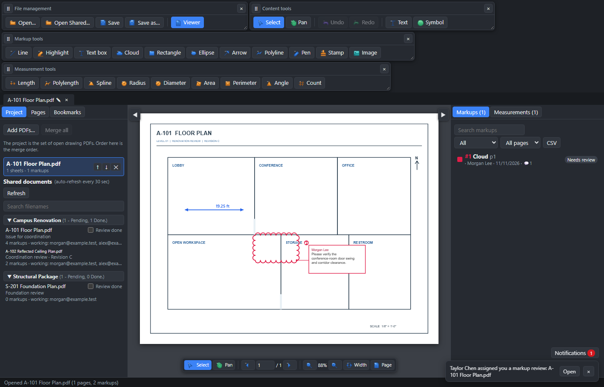
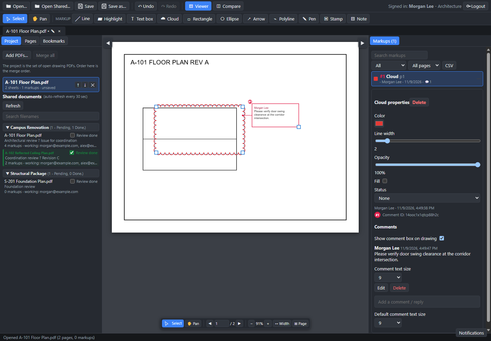
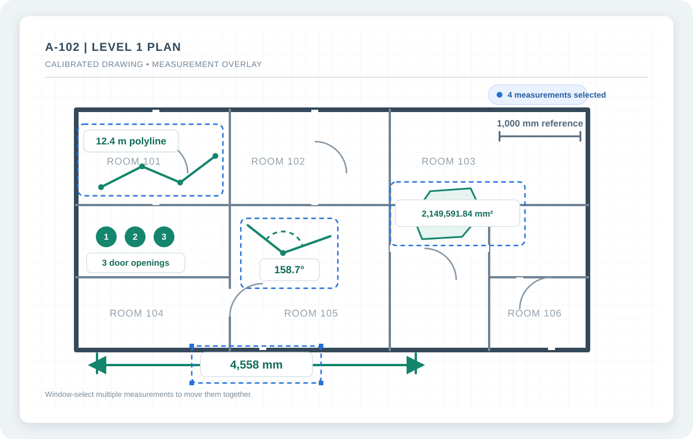
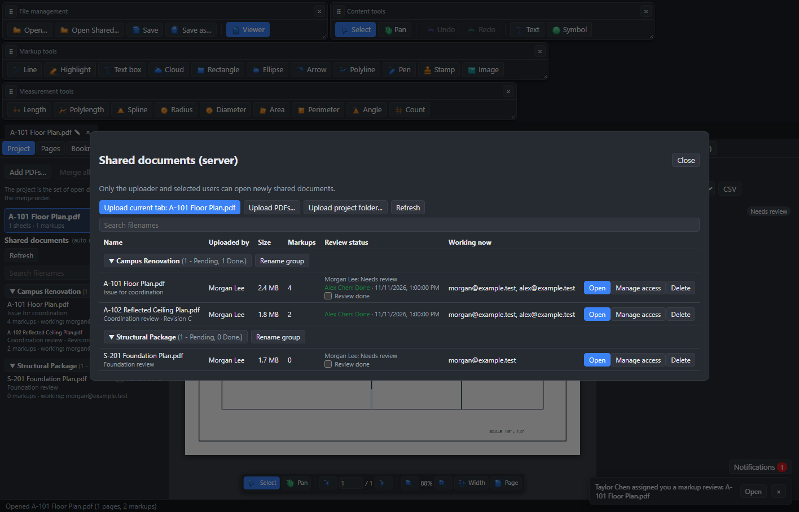

# ThryvoPDF Markup Studio User Manual

**A practical guide to viewing, marking up, measuring, and reviewing PDF drawings**

Version 1.0 · Updated November 2026

This manual follows the current ThryvoPDF Markup Studio 1.0 desktop build. It explains how to install and activate the app, work with drawing PDFs, and collaborate through a shared server.

## Contents

- [Before you begin](#1-before-you-begin)
- [Install, activate, and start the app](#2-install-activate-and-start-the-app)
- [Understand the workspace](#3-understand-the-workspace)
- [Open and read PDFs](#4-open-and-read-pdfs)
- [Add and edit markups](#5-add-and-edit-markups)
- [Measure drawings](#6-measure-drawings)
- [Compare drawing revisions](#7-compare-drawing-revisions)
- [Organize pages and bookmarks](#8-organize-pages-and-bookmarks)
- [Search text in open PDFs](#9-search-text-in-open-pdfs)
- [Shared documents and review assignments](#10-shared-documents-and-review-assignments)
- [Notifications](#11-notifications)
- [Administrator: users and server setup](#12-administrator-users-and-server-setup)
- [Shortcuts and menus](#13-shortcuts-and-menus)
- [Troubleshooting](#14-troubleshooting)
- [Data, compatibility, and limitations](#15-data-compatibility-and-limitations)

## 1. Before you begin

ThryvoPDF Markup Studio is a Windows desktop application for viewing, marking up, measuring, comparing, and organizing PDF drawing sets.

- **Unlicensed viewer:** You can open and view local PDFs without signing in. Editing, saving changes, and other licensed features are disabled until a license is imported.
- **Licensed desktop app:** A license is perpetual and tied to one Windows device. Import the license file on each licensed device.
- **Shared documents:** Multi-user collaboration requires a connection to your organization's ThryvoPDF server. The server administrator must install and maintain the separate **ThryvoPDF Server Manager** application.

Keep original PDFs or backups before making significant changes. Markups, measurements, bookmarks, and sheet information are stored in the saved PDF. Page organization operations change the document when you save it.

## 2. Install, activate, and start the app

### Install

1. Run the ThryvoPDF Markup Studio installer provided by your administrator.
2. Follow the setup prompts and launch **ThryvoPDF Markup Studio**.
3. If Windows displays an unsigned-app warning, verify that the installer came from your trusted software administrator before choosing to continue.

### Import a license

If you see **Unlicensed viewing - editing is disabled**:

1. Choose **Import license...** in the top toolbar, or open **Help > License...**.
2. In the License information window, copy the **Device request** and send it to the software owner through the agreed secure channel.
3. The owner returns a license file issued for this device.
4. Choose **Import license file...**, select that file, and wait for the activation status to update.
5. Restart the application if requested.

To license another computer, repeat the process on that computer and send its own device request. A license for one computer cannot be reused on another.

### Connect to a company server

If the connection screen appears:

1. Enter the server address supplied by your administrator, such as `https://pdf-server.example.com:8787` or `192.168.1.10:8787`.
2. Choose **Test connection** to check the address.
3. Choose **Connect**.
4. Sign in with your company account, or choose **Register another user** if registration is open.
5. Server registrations may require administrator approval before the account can sign in.

Use **Change** on the sign-in screen to update the server address. Choose **Use local accounts on this PC only** only if you intend to use a separate account store on this computer; local accounts are not shared with other PCs.

### Sign in and password

Enter your email and password on the sign-in screen. If an administrator issued a temporary password, the app requires you to choose a new password before continuing. Use **Option > Password...** to change your password later. There is no self-service password recovery; contact your administrator if you cannot sign in.

## 3. Understand the workspace

The main workspace has:

- **Top toolbar:** Open and save PDFs, undo/redo, switch Viewer or Compare, place PDF text and symbols, manage signatures, open shared documents, check notifications, and sign out.
- **Tabs:** Each open PDF has a tab. A dot indicates unsaved changes. Double-click a local PDF tab name to rename it; shared-document names cannot be renamed here.
- **Markup toolbar:** Select and Pan tools plus markup tools.
- **Measure toolbar:** A separate row directly below Markup. Choose Length, PolyLength, Area, Perimeter, Angle, or Count here. Choosing a measurement tool does not open the Measurements window.
- **Left panel:** Project, Pages, and Bookmarks tabs.
- **Right panel:** Markups and comment properties. The **Measurements...** button opens calibration and takeoff controls when you want them.
- **Floating controls:** Select/Pan, page navigation, zoom, Fit Width, and Fit Page at the bottom of the viewer.
- **Status bar:** Save and operation messages. After saving a local PDF, choose **Open saved PDF** in the status bar to open the saved file.

The side-panel toggles at the viewer edges, or **Ctrl+Alt+L** and **Ctrl+Alt+R**, show or hide the left and right panels.

*Figure 1. Main workspace: document navigation at left, the drawing canvas in the center, and markup properties at right.*

## 4. Open and read PDFs

1. Choose **Open...** or **Open PDF...** and select one or more PDF files. You can also drag PDF files onto the app window.
2. Switch between documents using their tabs.
3. Change pages using the page-number field or the previous/next buttons. **PageUp** and **PageDown** also navigate pages.
4. Zoom with the plus/minus controls, **Ctrl+=** / **Ctrl+-**, or Ctrl+mouse wheel.
5. Choose **Width** or **Page** in the floating controls to fit the page to the viewer.
6. To move around a zoomed page, select **Pan**, hold the middle mouse button, or hold **Space** temporarily while dragging.
7. Open the **Pages** tab in the left panel and select a thumbnail to jump to that page.

To close a document, choose the **X** on its tab or **File > Close Document**. Save changes first if you need to keep them.

## 5. Add and edit markups

### Add a markup

1. Open a PDF and choose a tool from the **Markup** toolbar.
2. Draw on the page:
   - **Highlight, Text, Rectangle, Ellipse, Line, Arrow:** click and drag to define the shape.
   - **Cloud:** click to add each vertex around the area, then press **Enter**, double-click, or right-click to finish.
   - **Pen:** click and drag to draw freehand.
   - **Polyline:** click to add points, then press **Enter**, double-click, or right-click to finish.
   - **Angle:** click three points to finish.
   - **Stamp** and **Note:** click to place.
3. For a Text box, edit the displayed text in the properties panel.
4. To choose another color, width, or opacity, set it in the toolbar before drawing or select the markup and change its properties in the right panel.
5. After placing a review markup, the **Add comment** dialog appears. Enter a comment and choose **Add comment**; press **Enter** to submit or **Shift+Enter** for a new line. **Cancel** leaves the markup without a comment.

Line and Stamp markups do not open the comment dialog. To add a comment later, select a review markup and use **Add a comment / reply** in the right panel.

There is no standalone Callout drawing tool. Comment boxes are attached to review markups when you add comments.

### Select, move, resize, or delete

1. Choose **Select** or press **V**.
2. Click a markup to select it. Drag the markup to move it; use its handles to resize supported shapes.
3. To move or resize a comment box, select its markup and drag the box. Drag the square at the lower-right corner to resize it.
4. To delete a selected markup, press **Delete** or use **Edit > Delete selected markup**. Deleting a markup also deletes its comments.
5. Use **Ctrl+Z** to undo or **Ctrl+Y** / **Ctrl+Shift+Z** to redo.

For shared documents, you can select and edit only your own markups and comments. The server checks this permission as well as the app. A markup can be deleted only by its author; only a comment's author can edit or delete that comment.

### Review markups, statuses, and comments

1. Open the **Markups** panel on the right.
2. Use **Search markups** to find markups by type, text, author, status, or comment text.
3. Choose a status filter or **All pages / This page** to narrow the list.
4. Select a markup in the list to select it on the drawing and show its properties.
5. Change its status, color, width, opacity, fill, or text in the properties panel when you have permission.
6. Add a comment in the comment input and press **Enter**. A comment's author and timestamp are shown in the panel.
7. To change the comment-box display, use **Show comment box on drawing**. Hiding the box does not delete comments.
8. Use **Comment text size** to adjust comment text size. The setting is remembered on this PC and used for the drawing and saved PDF.
9. Choose **CSV** in the Markups panel to export the current document's markup list.

The red numbered comment ID appears beside the comment box and in the Markups panel. It is not drawn at the corner of the markup. Stamps and drawing-only Line markups are not assigned review numbers.

*Figure 2. Select a markup to see its properties and associated comments.*

### Custom stamps

1. Choose **Stamp**.
2. Choose **Import stamp...** or use **Option > Tool defaults** to select a stamp image or a page from a PDF.
3. For a multi-page PDF stamp, choose the page to use.
4. Click the drawing to place the stamp, then use Select to move or resize it.

Supported stamp sources include common image formats and PDF files up to 20 MB. Imported PDF pages and animated images become still images.

### Cloud arc size

Create a Cloud by clicking each vertex around the area to outline, then press **Enter**, double-click, or right-click to finish. Select a Cloud markup and adjust **Cloud arc diameter** in the right-side properties. Smaller values make tighter, more frequent scallops; larger values make broader arcs. The setting is saved with the markup.

### Object stacking order

Right-click a placed Stamp, Text, Symbol, or Signature and choose **Bring to Front** or **Bring to Back** to change its drawing order relative to other stackable objects on that page. This order is preserved in saved PDFs by flattening these objects together as page content; other markups and comments remain PDF annotations. These commands are unavailable in read-only or live shared documents.

### Selecting multiple items

With the **Select** tool active, hold **Ctrl** (or **Command** on macOS) and click items to add or remove them one at a time; **Shift-click** also adds items. Alternatively, drag a selection window across the page to select annotations, measurements, comment boxes, Stamps, Text, Symbols, and Signatures. Drag any selected item to move the selection together. Comment boxes remain attached to their markup and can also be selected and repositioned separately.

### Text, symbols, and signatures

The **Text**, **Symbol**, and **Signatures** buttons are in the top toolbar immediately after **Compare**. These tools write to PDF page content rather than creating markup annotations, so they do not appear in the Markups list or markup count. Use them on local PDFs; live shared documents do not support these page-content edits.

- **Text:** Choose its size and color, then click the page to create a text object and enter its content. Press **Enter** to apply it; use **Shift+Enter** for a new line. Select and drag it to move, drag its corner to resize, and double-click to edit. It is regular PDF text content, not a text-box annotation, and can be searched or edited with a PDF editor that supports editing page content.
- **Symbol:** Choose a check, X, star, circle, plus/minus, question mark, or exclamation mark, set its size and color, then click the page. Select and drag the symbol to move or drag its corner to resize it. Symbols are flattened into page graphics when saved.
- **Signatures:** Choose **Signatures**, then upload one or more PNG files. For an image with a white paper background, select **Remove white background from uploaded PNGs** before uploading; white and near-white pixels become transparent. Leave it unchecked for PNGs that already have transparency or contain white ink. Manage the saved names and entries on this device. Choose **Place selected signature**, then click the page. Select and drag the signature to move or drag its corner to resize it. Signatures are flattened into PDF page content when saved.
- **Cut, copy, and paste:** Right-click a selected Text, Symbol, Signature, Stamp, or markup and choose **Cut**, **Copy**, or **Paste**. **Ctrl/Cmd+X**, **Ctrl/Cmd+C**, and **Ctrl/Cmd+V** work for the current selection too. A right-click Paste places the copied items around the clicked point; keyboard Paste offsets them from their original position.

Save the PDF after placing page content to keep the changes in the output file. Stamps, Text, Symbols, and Signatures are combined in their selected stacking order when saved; the original objects are no longer editable in the saved copy. Other markups and comments remain PDF annotations. The signature list is stored locally on the current device and is not synchronized to the shared server.

## 6. Measure drawings

Calibrate each page before relying on measurement values. Uncalibrated values represent paper size, not real-world dimensions.

Measurement tools are available in the **Measure** toolbar directly below **Markup**, and from **View > Measurements**. You can start a measurement from the toolbar without opening the Measurements window. The separate **Measurements...** toolbar button or **View > Open measurements panel...** opens calibration and takeoff controls.

Measurements are drawing checks, not review comments: placing one does not open a comment dialog, and measurements are excluded from the markup-comment CSV. The calibration and appearance are saved with the PDF so the displayed and reopened saved measurements use the same value and unit formatting.

### Calibrate from a known distance

1. Open the **Measurements...** panel from the toolbar, or choose **View > Open measurements panel...**.
2. Choose **Calibrate (pick 2 points)**.
3. Click and drag between two points on a dimension whose real-world length you know.
4. Enter the known distance and unit (ft, in, m, or mm), then choose **Apply**.
5. Select **Apply to all pages** first if the same scale applies throughout the document.

### Calibrate from a drawing scale

1. In Measurements, enter the real-world length represented by **1 in on paper**.
2. Choose the scale unit and choose **Set scale**.
3. Select **Apply to all pages** if appropriate.

### Create takeoffs

1. In Measurements, enter a **New measurement subject**, such as `Exterior wall` or `Doors`.
2. Choose a measurement tool: Length, PolyLength, Area, Perimeter, Angle, or Count.
3. Draw the measurement on the page. Multi-point tools are finished with **Enter**, double-click, or right-click; Angle finishes after its third point.
4. The measurement appears on the drawing. The Measurements panel stays closed unless you open it; the tool remains active for another measurement.
5. Open **Measurements...** to review entries and totals in the **Takeoff** table, choose an output unit, or export the takeoff.
6. Choose **Export CSV** to save the takeoff. The date column uses local time in `M/D/YYYY HH:mm` format.

The Takeoff table is separate from the Markups panel. Measurement entries are not comments and are not included in markup-comment CSV exports. Page calibration is saved in the PDF, but is not synchronized to other collaborators on a shared document. Coordinate measurement assumptions with your team before sharing quantities.

### Read the measurement labels

- **Length** shows the calibrated distance between the two picked points.
- **PolyLength** totals the connected segments you draw.
- **Area** reports the enclosed area, using a squared unit (for example, `mm²`).
- **Perimeter** reports the total boundary length of a closed shape.
- **Angle** reports the angle formed by three points.
- **Count** places a numbered marker. The Takeoff table groups counts by subject.

In the example, labels are shown directly on the drawing. Counts are numbered in the drawing and summarized by subject in Takeoff. Multiple measurement markups can also be selected together and moved as a group. Always confirm the active page's calibration and unit before using quantities.

*Figure 3. Measurement overlay with a group of selected measurements. Values are illustrative; calibrate your own drawing before measuring.*

## 7. Compare drawing revisions

1. Open both PDFs as tabs. For a revision not yet open, choose **Open revision...** from Compare.
2. Choose **Compare** in the top toolbar.
3. Select the older drawing as **A (old)** and the newer drawing as **B (new)**. Set the page number for each.
4. Choose **Compare** to calculate visual differences.
5. Select a display mode:
   - **Overlay differences:** red indicates removed content (A only), blue indicates added content (B only), and gray indicates unchanged content.
   - **Differences on faded A:** shows the changes over a faded view of A.
   - **Side by side:** displays both pages next to each other.
6. Adjust **Tolerance** if small raster differences create too much noise.
7. Choose **Auto-align** if the pages are shifted. Use the arrow buttons to nudge the alignment one pixel at a time.
8. Use the plus/minus buttons to zoom the comparison.
9. In Overlay or Ghost mode, choose **Export PNG** or **Export PDF** to save the result.

Compare is raster-based and finds visual differences; it does not interpret drawing objects or text semantics.

## 8. Organize pages and bookmarks

### Organize pages

1. Open **View > Organize pages...**.
2. Select one or more page thumbnails. Use Ctrl or Shift for multi-selection; drag a page to reorder it.
3. Choose Rotate left/right, Delete, Duplicate, or **Extract → new PDF**.
4. To split, enter page ranges such as `1-3, 4, 5-`, or choose an interval in **or every ... pages**, then choose **Split to folder...**.
5. To insert pages, choose another open PDF or **Browse for file...**, enter page ranges if needed, then choose where to insert.
6. Save the PDF to preserve page changes.

If no page is selected, applicable actions can apply to all pages. The app prevents deleting every page.

### Bookmarks

1. Select the **Bookmarks** tab in the left panel.
2. Enter a title and choose **Add**. If the title is blank, the app uses the sheet title or page number.
3. Use a page button to navigate to a bookmark.
4. Edit a title, move it up/down, indent/outdent it, or delete it.
5. Save the PDF to store the bookmark outline.

## 9. Search text in open PDFs

1. Open a PDF, switch to **Viewer** if needed, and choose **View > Search text in open PDFs...** or press **Ctrl+Shift+F**.
2. Enter the text to find and choose **Search** or press **Enter**.
3. Leave **All open documents** checked to search every open PDF; uncheck it to search only the active PDF.
4. Select a result to navigate to its page.

Text search is available in unlicensed viewer mode as well as licensed mode. It searches PDF text layers; scanned pages without OCR text cannot be searched.

## 10. Shared documents and review assignments

Shared documents are available when the app is connected in server mode. A signed-in, licensed user can upload, collaborate on, and update their assigned review status. In unlicensed viewer mode, shared content is read-only.

*Figure 4. Shared-document groups and reviewer status are visible in the library.*

### Find and open shared PDFs

1. Choose **Open Shared...** in the toolbar, **Shared Documents...** on the welcome screen, or **File > Open Shared...**.
2. Use **Search filenames** to filter by document filename. The search is case-insensitive. Clear the field to see all files.
3. Documents are grouped by project. Expand or collapse a group with its arrow.
4. The group heading shows counts such as **(4 - Pending, 1 Done.)**. A document is Done only if it has assigned reviewers and every assigned reviewer is done; mixed or unassigned reviews count as Pending. Counts update for the current search results.
5. Select **Open** to open a shared PDF. The currently open shared PDF is highlighted.
6. In the left **Project** panel, the shared list also refreshes automatically about every 30 seconds while visible. Use **Refresh** to reload immediately.

### Upload a PDF or project folder

1. Open **Shared Documents**.
2. Choose **Upload current tab**, **Upload PDFs...**, or **Upload project folder...**.
3. Choose a group (existing, new, or no group) and optionally enter a description.
4. Select the users who should have access. The uploader retains access; without selecting others, only the uploader can access the new document.
5. Choose **Upload** and review the result or per-file upload status.

Uploads must be PDFs no larger than 150 MB each. Folder upload retains subfolder names as labels; it does not create separate folder permissions. Selection is limited to 500 PDFs. An upload with a large number of existing markups may take longer to complete.

### Manage access

Only the uploader can change a document's access list:

1. In Shared Documents, find the uploaded document and choose **Manage access**.
2. Select or clear the users who should have access.
3. Choose **Save access**.

The administrator can delete a document or group only where they have the required access. Group rename and deletion permissions depend on the uploader/admin role and access to the documents in the group. Deleting a document or group removes it for everyone and cannot be undone.

### Mark your review done or reopen it

1. In the left **Project** panel or Shared Documents window, find a document assigned to you.
2. Tick **Review done** when your review is complete. Untick it to reopen your review.
3. Your status is separate from other reviewers' statuses. A document's group count becomes Done only after every assigned reviewer has completed their review.
4. If markup content changes after completion, the server reopens reviews for the updated markup revision.

Newly assigned reviewers receive an in-app alert and, if the administrator has configured email, an assignment email. The uploader receives an email when a reviewer marks a review done, with assigned users copied, if email is configured. Reopening a review sends an in-app alert to other assigned reviewers; completion and reopening status is also visible in the document list.

### Work in a shared PDF

1. Open the document from Shared Documents.
2. Add and edit markups using the same viewer tools as a local PDF.
3. Changes sync automatically. The shared-document banner shows who is working in the document and whether your connection is live.
4. If offline or your session expires, the banner displays a warning. Keep the document open and restore the connection so pending changes can sync.
5. You can move, resize, edit, or delete only markups and comments you authored. The server enforces these restrictions.

Shared documents sync markups and comments, not page calibration, bookmarks, or page organization. Page reorder, rotate, and insert are unavailable on shared tabs. If two people edit the same markup at the same time, the last change accepted by the server wins.

## 11. Notifications

In server mode, choose **Notifications** in the top-right area:

- The unread count appears on the button.
- Assignment, review, and pending-registration alerts appear in the inbox. Newly assigned reviewers are notified in-app; they also receive an email when the administrator has enabled and configured assignment email.
- Choose **Open** on an alert to go to Shared Documents or, for a registration alert, user management.
- Choose **Mark read** on an alert or **Mark all read** in the inbox.
- The inbox refreshes automatically about every 30 seconds.

Assignment alerts always appear in-app. Email is optional and is configured by the server administrator. Email delivery problems do not prevent document uploads or review-status changes.

## 12. Administrator: users and server setup

### Approve and manage accounts

Administrators can open **Option > Users...**:

1. Review the **Pending approval** list.
2. Choose **Approve** or **Reject** for a registration.
3. Use the user table to change a role, disable/enable an account, reset a password, or delete an account.
4. A reset password is shown once; securely give it to the user. The user must change it at next login.

Use **Option > Password...** to change your own password. New server installations create an administrator; its initial password is generated by the server or configured by the installer/admin. Change it at first sign-in and have the administrator remove any initial-password file as directed by the server setup process.

### Install or update Server Manager

Server Manager runs the collaboration service as an automatic-start Windows service:

1. Install **ThryvoPDF Server Manager** on the server PC.
2. Open it and choose a dedicated local **Server data folder** and port.
3. Choose **Install service...** and approve the Windows administrator prompt.
4. Wait for the service status and health check to show that it is running.
5. Provide client users with the server address and port.
6. Configure Windows Firewall and network access only as required for your trusted network; the manager does not create firewall rules automatically.

For an existing deployment, update Server Manager while reusing the same data folder to retain users and documents. Do not delete the data folder. Before upgrading the manager, stop and uninstall the Windows service, install the new manager, then install the service again with the same port and data folder. Uninstalling the service does not delete its data. Stop and uninstall the service before changing its port/data folder or uninstalling the manager.

The server data folder contains user accounts, shared PDFs, markup data, and notification/email settings. Restrict its access and back up the entire folder with the service stopped. Do not run another server process against that folder at the same time.

The server uses HTTP unless an administrator separately configures TLS. Plain HTTP exposes credentials and documents to other parties on the network; use only on a trusted network or configure HTTPS and certificates appropriate for your organization.

### Configure assignment email

1. Start the server service and open Server Manager.
2. In **Assignment notifications**, enable email and select a provider.
3. For Gmail/Google Workspace, use `smtp.gmail.com`, port `587`, STARTTLS, the full mailbox address, and an App Password. Google requires 2-Step Verification to create an App Password; a normal account password will not work.
4. For Outlook.com, use `smtp-mail.outlook.com`, port `587`, STARTTLS, the full mailbox address, and an app password if two-step verification requires it.
5. For Microsoft 365, prefer **Microsoft 365 - Microsoft Graph** if SMTP authentication is blocked. An Entra administrator must register an application, provide its tenant ID, client ID, and client secret value, grant Microsoft Graph application permission `Mail.Send`, and grant admin consent. Set **From** to an existing Exchange Online mailbox.
6. If using SMTP for Microsoft 365, the administrator must allow Authenticated SMTP (SMTP AUTH) for the mailbox and satisfy the tenant's authentication policy.
7. Enter the sender address, save the settings, then send a test email to verify the configuration.

The manager saves email credentials in the server data folder's `notify.json`; limit access to that folder. Graph `Mail.Send` can permit sending as other mailboxes in the tenant unless an administrator restricts it. Follow the organization's security policy when creating and limiting the mail application.

## 13. Shortcuts and menus

| Shortcut | Action |
|---|---|
| `Ctrl+O` | Open PDF |
| `Ctrl+S` | Save |
| `Ctrl+Shift+S` | Save As |
| `Ctrl+Z` | Undo |
| `Ctrl+Y` or `Ctrl+Shift+Z` | Redo |
| `Delete` | Delete selected markup |
| `V` | Select tool |
| `H` | Toggle Pan |
| Hold `Space` while dragging | Temporary Pan |
| `Ctrl+=` / `Ctrl+-` | Zoom in / out |
| `Ctrl+Alt+L` | Show or hide left panel |
| `Ctrl+Alt+R` | Show or hide right panel |
| `Ctrl+Shift+F` | Search text in open PDFs |
| `PageUp` / `PageDown` | Previous / next page |
| `Enter` / double-click / right-click | Finish multi-point markup |

On Windows, use **Alt+F**, **Alt+E**, **Alt+O**, **Alt+V**, or **Alt+H** to open the File, Edit, Option, View, or Help menus. Shortcuts are ignored while focus is in text fields.

## 14. Troubleshooting

| Problem | What to try |
|---|---|
| Cannot connect to the server | Check the server address and port with your administrator. Use **Test connection**. Confirm the service is running and the port is allowed through the firewall. |
| Sign-in says approval is pending | Ask a server administrator to approve the account in **Option > Users...**. |
| Shared Documents is unavailable | Confirm that you are connected in server mode, signed in, and using a current server build. Ask the administrator to update the server files/service if the server does not support a feature. |
| Assigned user does not appear | The uploader should open **Manage access**, select the user, and choose **Save access**. Verify that the user is signing in with the assigned email address. |
| Review checkbox is missing | Only assigned reviewers have a completion checkbox. Confirm the current user is assigned and refresh the list. |
| Review count does not show Done | Every assigned reviewer must mark their own review done. Documents with no assigned reviewers count as Pending. |
| Markup is not editable in a shared PDF | Shared markups can only be changed by their author. Verify the signed-in account and select your own markup. |
| Shared changes are not syncing | Check the collaboration banner for Offline or Session expired. Restore the network connection, sign in again if required, and allow the pending changes to sync. |
| Email test fails | Check provider host/port, sender, mailbox credentials, and provider-specific requirements. For Graph, confirm the secret **value** is current and `Mail.Send` admin consent was granted. |
| Search finds no text | Text search requires a text layer. Run OCR on scanned PDFs in another tool if searchable text is needed. Filename search in Shared Documents is separate from drawing text search. |
| Measurements look wrong | Recalibrate the page using a known distance or drawing scale, and confirm the units. |
| PDF opens but editing is disabled | Import a valid license for this device. Unlicensed mode is read-only. |
| Changes are missing after closing | Save the PDF before closing. A dot on the tab indicates unsaved changes. |

## 15. Data, compatibility, and limitations

- Save local document changes with **Save** or **Save As...**. Markups are written as PDF annotations and ThryvoPDF also stores private metadata used to restore editable app data.
- CSV exports are separate files and do not replace the PDF.
- Annotations made by other PDF applications may display read-only, depending on their format and PDF.js support. Rich-text editing of external annotations is not supported.
- Other PDF viewers can display saved appearances, but comment popups may look different. Appearance rendering has not been verified in every third-party PDF reader.
- Shared documents contain copies of PDFs and cannot be remotely revoked after a user has downloaded them.
- Local-account mode does not share accounts, files, or markups with other computers.
- The Windows installer is unsigned.

For server installation details, backup procedures, network security, and service maintenance, ask your administrator to follow the deployment documentation provided with the current ThryvoPDF Server Manager.
